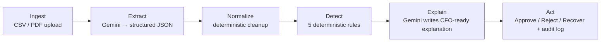

# LedgerLens

> **The explainable AI auditor that finds duplicate payments, contract overcharges, currency errors, and unearned credits across an enterprise's spend — then shows finance exactly why.**

LedgerLens continuously compares a company's contracts, purchase orders, invoices, payments, and vendor master data to find money the company should not have paid — or can recover.

It never vaguely says *"this invoice looks suspicious."* Every alert carries a full proof trail: the exact invoice line, contract clause, PO line, payment record, the rule that fired, and a plain-English explanation a CFO can forward to procurement.

**Built for the Google AI Buildathon** — powered by Gemini, deployed on Google Cloud.

---

## Why this exists

The problem is real and quantifiable:

- One analysis of **$240 billion** in enterprise payment value found **$5 billion** in payment errors prevented — **duplicates accounted for roughly half** of affected value; data-entry errors and currency mismatches **~20% each**.
- **61%** of duplicate invoices paid twice had **non-identical invoice numbers** — so fuzzy matching matters, not exact-match dedup.
- AP automation is a global multi-billion-dollar market (~$2.99B in 2025 → ~$7.26B by 2033).

The sales pitch writes itself: *LedgerLens pays for itself from recovered overpayments.*

## What we are building (MVP)

Exactly **five** deterministic checks — small enough to build in two days, valuable enough to demo in two minutes.

| # | Check | What it catches | Rule ID |
|---|-------|-----------------|---------|
| 1 | Duplicate & near-duplicate invoices | Same invoice resubmitted with altered numbers, dates, or vendor names | `R1` |
| 2 | Contract price leakage | Invoiced unit prices above contracted rates; missed agreed discounts | `R2` |
| 3 | PO mismatch & overbilling | Billed above PO quantity, before delivery, or for items not on the PO | `R3` |
| 4 | Currency & tax errors | Wrong currency, incorrect FX conversion, duplicate/invalid tax charges | `R4` |
| 5 | Cancelled-service leakage | Recurring charges for cancelled software, terminated contracts, returned goods | `R5` |

### The pipeline



### Explainability is the moat

Finance teams will not trust *"AI says this is fraud."* Every LedgerLens finding looks like this:

> **Finding:** Possible duplicate payment — ₹4,956.00
> **Evidence:** `INV-8821` and `INV-8821-R2`, same vendor, same amount, two-day gap, 96% line-item similarity.
> **Rule:** *Same vendor + same amount + near-identical line items + no credit note → duplicate-risk.*
> **Sources:** Original PDF, PO-1001, payment records, contract clause.
> **Recommended action:** Block second payment; request vendor credit note; assign to AP analyst.
> **Confidence:** High — confirm whether this is a legitimate revised invoice.

That makes it **audit-ready** — which matters enormously in enterprise sales.

## Architecture (one line)

> **Gemini extracts and explains. The rules engine decides. The workflow logs.**
> The LLM is never the only source of a finding — that is what makes LedgerLens defensible and audit-ready.

| Layer | Choice (MVP) | Production path |
|-------|--------------|-----------------|
| Backend | Python 3.11+ · FastAPI | Google Cloud Run |
| Detection engine | Pure deterministic Python rules | Same (this is the moat) |
| AI | Gemini 2.5 Flash — structured extraction + explanation | Vertex AI |
| Database | SQLite | Cloud SQL / Firestore |
| Frontend | React + Vite + Tailwind | Cloud Run / Firebase Hosting |
| Files | Local `uploads/` | Cloud Storage |

## Repository layout

```
Ledgerlens/
├── README.md               ← you are here
├── CONTRIBUTING.md         ← branch / commit / PR rules — read before coding
├── docs/                   ← the seven team documents (read 01 → 07)
│   ├── 01_PRODUCT_SPEC.md
│   ├── 02_ARCHITECTURE.md
│   ├── 03_DATA_MODEL.md
│   ├── 04_DETECTION_RULES.md
│   ├── 05_API_SPEC.md
│   ├── 06_GEMINI_INTEGRATION.md
│   └── 07_BUILD_PLAN.md
├── backend/                ← FastAPI app + detection engine (skeleton with TODOs)
│   ├── app/
│   │   ├── main.py
│   │   ├── ingest/         (upload handling)
│   │   ├── extract/        (Gemini → JSON)
│   │   ├── normalize/      (deterministic cleanup)
│   │   ├── detect/         (the 5 rules — explainable core)
│   │   ├── explain/        (Gemini explanations)
│   │   └── ...
│   ├── schema.sql
│   ├── requirements.txt
│   └── tests/
├── frontend/               ← React dashboard (spec in frontend/README.md)
└── sample_data/            ← demo dataset with 6 planted anomalies + clean controls
```

## Quickstart

**Backend** (Python 3.11+):

```bash
cd backend
python -m venv .venv
.venv\Scripts\activate            # Windows  (macOS/Linux: source .venv/bin/activate)
pip install -r requirements.txt
copy .env.example .env            # then put your GEMINI_API_KEY inside .env
uvicorn app.main:app --reload
# → http://127.0.0.1:8000/docs
```

**Frontend** (Node 20+):

```bash
cd frontend
npm create vite@latest app -- --template react
cd app && npm install && npm install tailwindcss
npm run dev
```

Full setup walkthrough (including getting a Gemini API key): see **docs/07_BUILD_PLAN.md** and the offline context pack.

## Sample data

`sample_data/` contains a small, coherent demo dataset with **six planted anomalies** (duplicate payment, contract overcharge, PO overbilling, currency mismatch, cancelled-service charge, tax error) plus clean "control" invoices that must **not** raise findings. Load it, run the detectors, and check yourself against `sample_data/README.md`.

## Buildathon deliverables checklist

- [ ] Upload invoices, POs, contracts, payment ledger (CSV/PDF)
- [ ] Gemini extracts invoice & contract fields into structured JSON
- [ ] Deterministic checks: duplicates, PO overbilling, price mismatch, currency errors
- [ ] Exception dashboard: severity, amount at risk, evidence links, explanation
- [ ] Reviewer approve/reject with logged decisions
- [ ] One-click **audit memo** for finance leadership
- [ ] Deployed on Google Cloud + 90-second demo video

## Non-goals (do NOT build these)

- A full ERP, payment rails, or autonomous payments.
- Black-box fraud scores without evidence.
- ERP connectors (SAP/Oracle/NetSuite) — CSV/PDF upload is enough for the MVP.

Build the **detection, explanation, and workflow layer** — that is where the value and defensibility are.

---

**Team note:** the project context pack (`Context_File/`) is shared manually by the team lead and is deliberately **not** part of this repository. Never commit it, never commit `.env` or API keys. See `CONTRIBUTING.md`.
